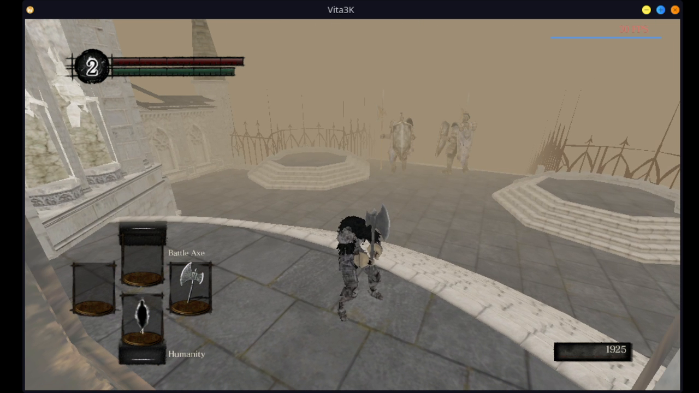
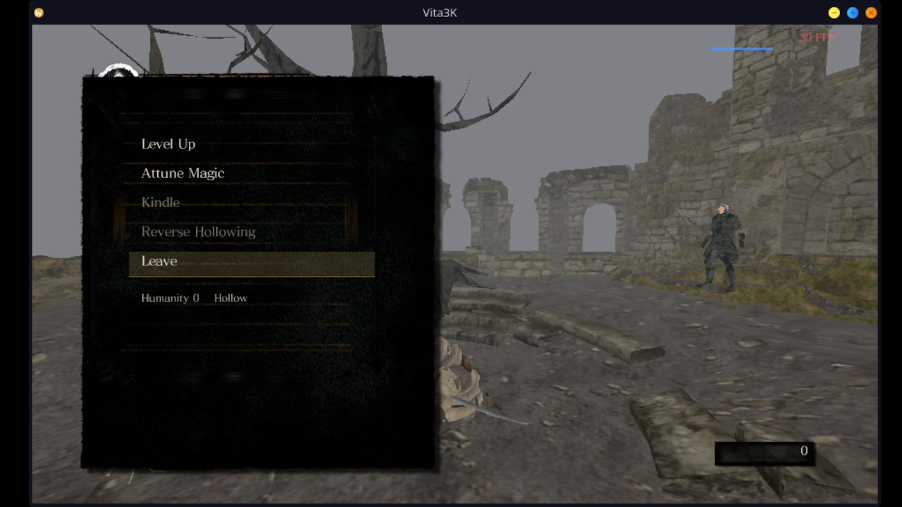
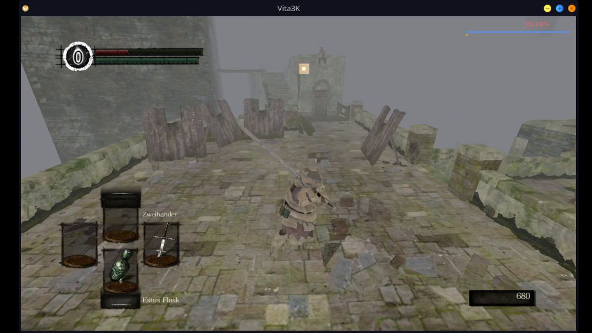
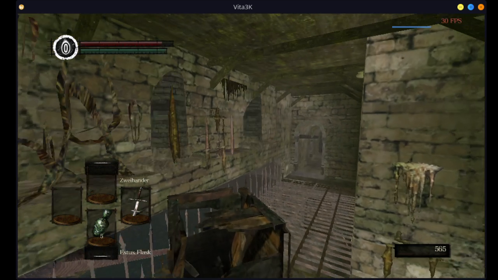
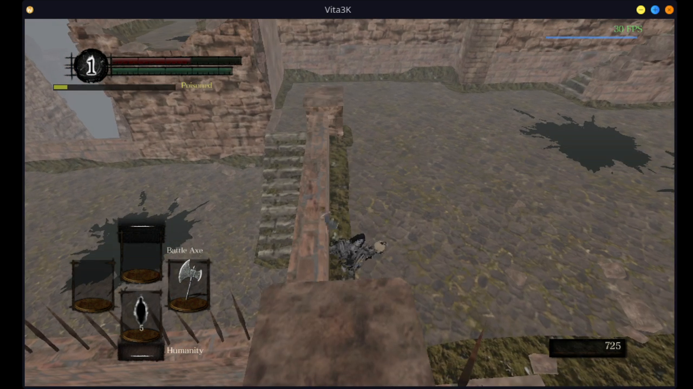
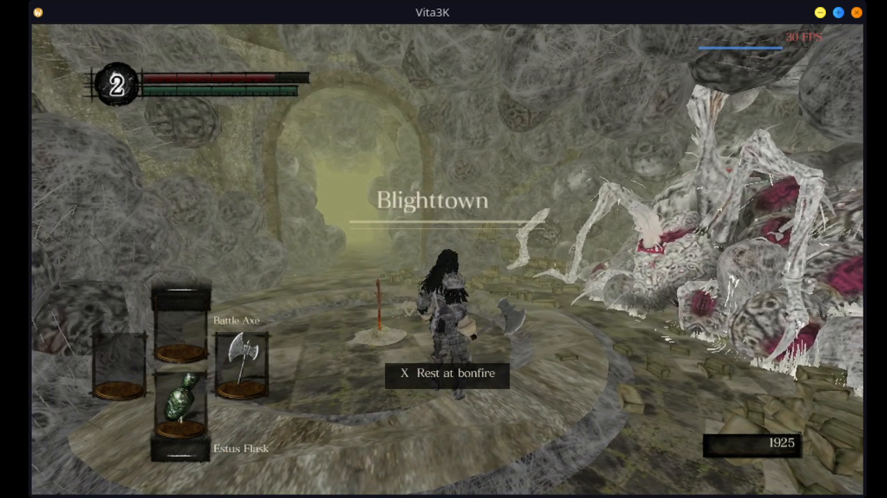

# DS1Vita

**Dark Souls Remastered (with the DLC) running on the PlayStation Vita**, on a custom engine written from scratch.

This repo is the project's showcase: devlogs, screenshots and videos. The only download is the engine's VPK (see [Releases](../../releases)).

## What it is

- **A new engine** (C, vitaGL) that runs on the Vita, plus a PC twin for testing.
- **Converters** that turn *your own* Steam copy of Dark Souls Remastered into compact Vita data files: maps, characters, animations, sounds, params, event scripts.
- **No game files are distributed.** The VPK holds only the engine. It does nothing without data converted from a copy of the game you own, and the converters are not public yet.

## Where it is (build r89, November 2026)

- All 17 areas, the DLC included: Asylum, Firelink, Burg/Parish, Depths, Blighttown, Darkroot, Oolacile, Valley/New Londo, Sen's Fortress, Anor Londo, Catacombs, Tomb, Great Hollow/Ash Lake, Demon Ruins/Izalith, Archives, Painted World, Kiln.
- World streaming: collision, textures and meshes are paged in and out as you move.
- Combat, stamina, poise, hit reactions from the game's own tables, poison/toxic/bleed/curse.
- **Enemies fight with the game's own Lua AI scripts**: 111 of 139 enemy types, nearly every boss among them.
- The game's event scripts (EMEVD) and NPC talk scripts (ESD) run in the engine: story flags, NPC placement, dialogue, shops.
- Bonfires (rest, level up, attune, kindle, warp), inventory, equipment, the game's own menu layouts, saves.
- Ladders, doors (including one-way shortcuts), mimics, fog walls with bosses.
- Title screen, character creation, the prologue.
- Locked 30 fps for even frame pacing.

## Screenshots

| | |
|---|---|
|  |  |
|  |  |
|  |  |

## Videos

- [2026-11-12: 17-minute gameplay demo](https://youtu.be/sR8_dW53E9s) (Vita3K, PS5 controller), from the Burg through the Catacombs, Anor Londo and Blighttown.

## Devlogs

- [2026-11-12: build r89](devlogs/2026-11-12-r89.md): touch lock-on, Debug Start, 30 fps lock, PS5 controller in Vita3K

## Controls (Vita)

| Button | Action |
|---|---|
| Left stick / right stick | Move / camera |
| R1 / L1 | Attack / guard |
| Rear touch right / left | Strong attack / parry |
| Circle (tap / hold) | Roll / sprint |
| Cross | Interact, talk, rest |
| Square / Triangle | Use item / two-hand |
| D-pad left / right / down | Switch left hand / right hand / item |
| **Tap the screen** | Lock on (tap again to release), right stick switches target |
| START | Menu |

On a PS TV or in Vita3K's PS TV mode, a controller's L2 / R2 parry and strong-attack, and **R3 locks on**.

## Disclaimer

A non-commercial fan project. Not affiliated with or endorsed by FromSoftware or Bandai Namco Entertainment. Dark Souls and all related names, art and assets belong to their owners. Buy the game: [Dark Souls Remastered on Steam](https://store.steampowered.com/app/570940/).
